# Tokyo Doppler

A first-person Unreal Engine 5.7 demo built around two custom MetaSound nodes written in C++: a feedback delay line on the rifle, and a Doppler pitch calculator on a rocket thruster bolted under a maglev train. Stand under the track as the train goes over and the engine drops in pitch as it passes.

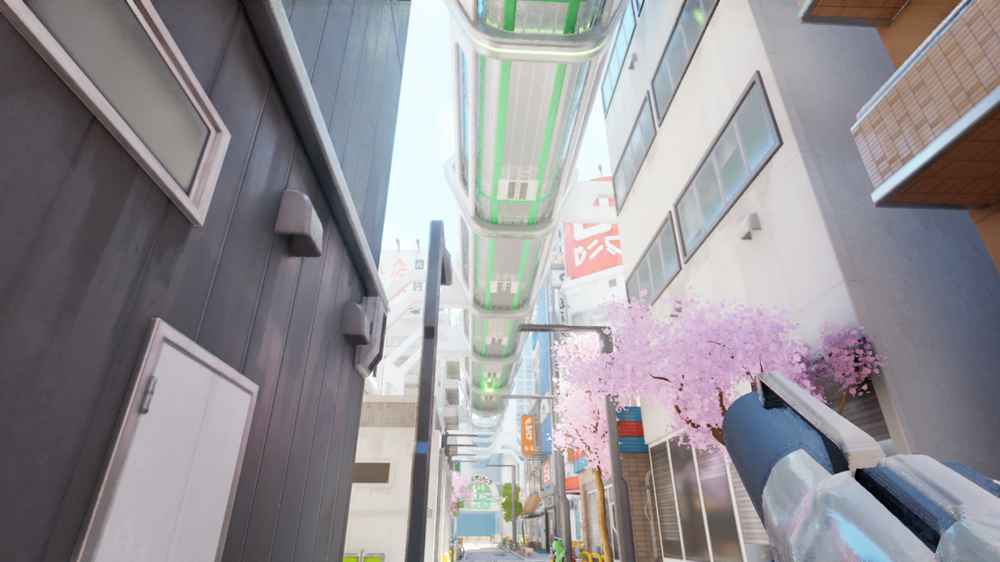

**[Download the Windows build](https://github.com/madam6/tokyo-doppler/releases/latest)** (461 MB zip, Windows 10/11 with a DirectX 12 GPU, no Unreal install needed) or [build it from source](#building-from-source).

| Node | Inputs | Output | Used in |
|---|---|---|---|
| Delay line | delay (s), feedback (0 to 1), audio | audio | `MSS_DelayLineGunshot`, the rifle's fire sound |
| Doppler Calculator | speed of sound, observer velocity, source velocity (cm/s) | pitch multiplier | `MSS_DopplerJetEngine`, on `BP_DopplerThruster` |

Both nodes live in the game module (`Source/DspAp/Audio`) and register with `METASOUND_REGISTER_NODE`, so they show up in the MetaSound editor's node list like the built-in ones. 21 automation tests cover them.

<p>
  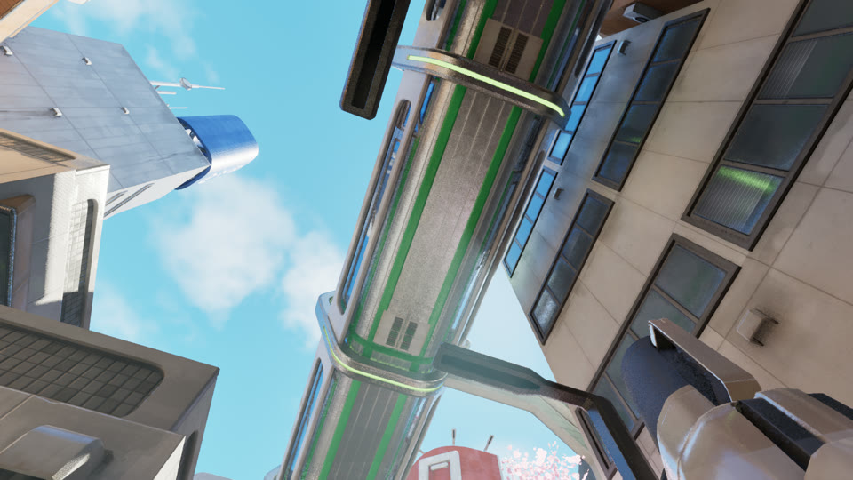
  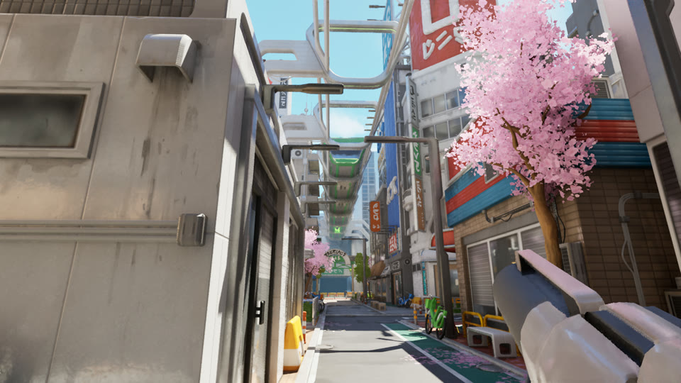
  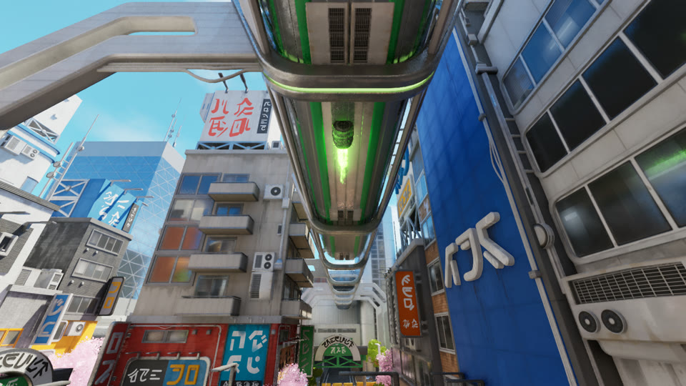
  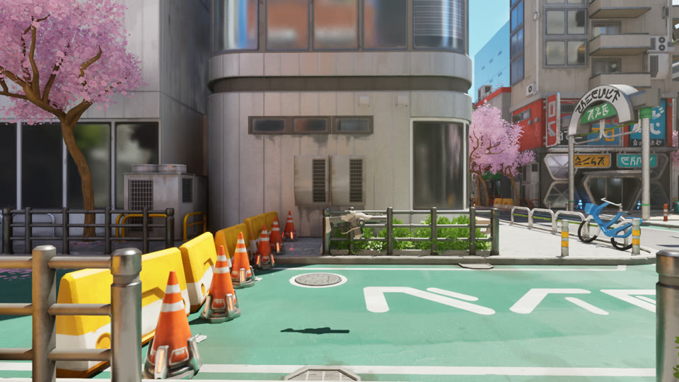
</p>

## Controls

| Input | Action |
|---|---|
| WASD / mouse | move / look |
| Space | jump |
| Walk into the rifle | pick it up (it is on the road in front of the spawn point) |
| Left mouse | fire |

The maglev comes by every 30 seconds on the elevated track over the narrow road behind and to the right of the spawn point.

## Delay line

`CircularBuffer` holds two seconds of samples (96,000 at 48 kHz) in a `TArray` that is allocated once, when the operator is built, so nothing on the audio thread allocates. `Add()` writes at the head and advances it with a modulo; `Read()` turns the delay time into a sample count, steps back from the head and wraps negative indices.

The per-sample loop in `DelayLine::Execute()`:

```cpp
const float dryInput = InputBuffer[i];
float delayedInput = m_CircularBuffer.Read(DelaySeconds, m_SampleRate);  // wet
OutputBuffer[i] = dryInput + delayedInput;
delayedInput *= Feedback;
m_CircularBuffer.Add(dryInput + delayedInput);                           // feed back
```

The buffer stores $w[n] = x[n] + g\,w[n-N]$ and the output is $y[n] = x[n] + w[n-N]$, which gives

$$H(z) = \frac{1 + (1-g)\,z^{-N}}{1 - g\,z^{-N}}$$

With no feedback this is a feedforward comb filter, $y[n] = x[n] + x[n-N]$: +6 dB peaks at multiples of $1/\text{delay}$ and nulls halfway between. Feedback adds poles at the same frequencies, so the peaks get taller and narrower, reaching $(2-g)/(1-g)$ (+15.6 dB at $g = 0.8$), while the nulls fill in. With delays of a few milliseconds that comb is what you hear, a metallic, flanger-like colour. Past roughly 50 ms the peaks are too close together to register as pitch and the ear hears separate echoes instead.

<picture>
  <source media="(prefers-color-scheme: dark)" srcset="Docs/images/delay_response_dark.svg">
  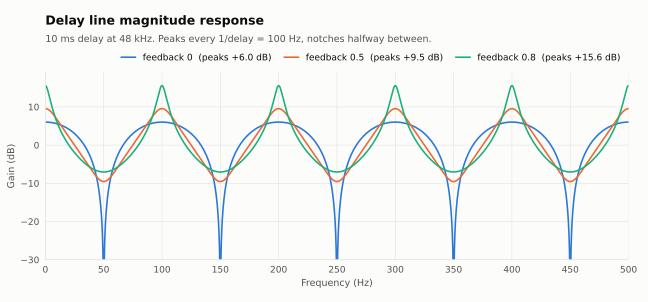
</picture>

<picture>
  <source media="(prefers-color-scheme: dark)" srcset="Docs/images/delay_impulse_dark.svg">
  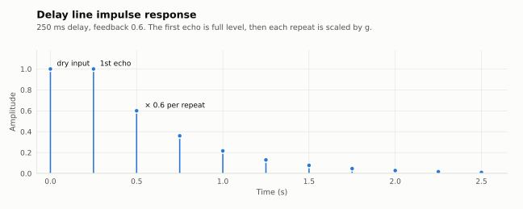
</picture>

The rifle uses 200 ms and feedback 0.5. Two guards keep user input from breaking things: the read index is clamped, so a negative delay or one longer than the buffer can't read outside the array, and feedback is clamped to ±0.999 so the loop always decays.

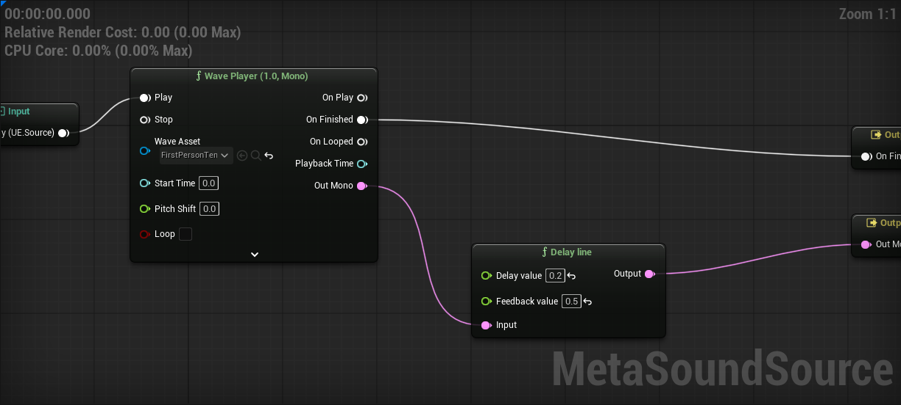

Here is one shot recorded from the game's main output. The decay follows the −6 dB per repeat that feedback 0.5 should give. ([listen](Docs/audio/gunshot_delay.wav))

<picture>
  <source media="(prefers-color-scheme: dark)" srcset="Docs/images/ingame_gunshot_dark.svg">
  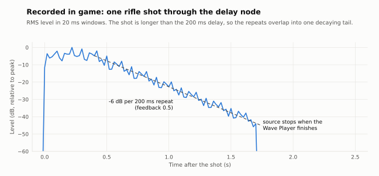
</picture>

## Doppler effect

The node is small. It computes the classic ratio

$$\frac{f_o}{f_s} = \frac{c + v_o}{c - v_s}$$

with both velocities positive when moving towards the other party, returns 1.0 when the source is within 0.0001 of the speed of sound (to avoid dividing by zero), and clamps negative results to 0 because past Mach 1 the ratio flips sign. Inputs are in cm/s to match Unreal's world units, so the speed of sound defaults to 34300.

The work is in feeding it. `BP_DopplerThruster` is attached under one of the maglev cars, which a level sequence moves along the track. On every tick the Blueprint:

1. estimates the thruster's velocity from how far it moved since the previous tick, and reads the player's velocity,
2. takes the line of sight between thruster and player and projects each velocity onto it with a dot product, which drops sideways motion and leaves only the radial speed,
3. sends the two radial speeds to the MetaSound as float parameters, which feed the node's source and observer velocity pins.

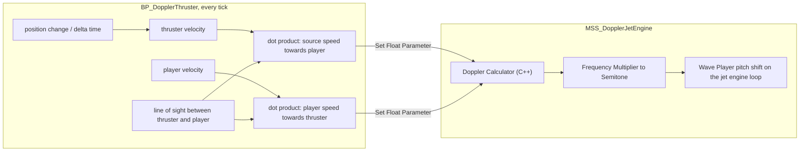

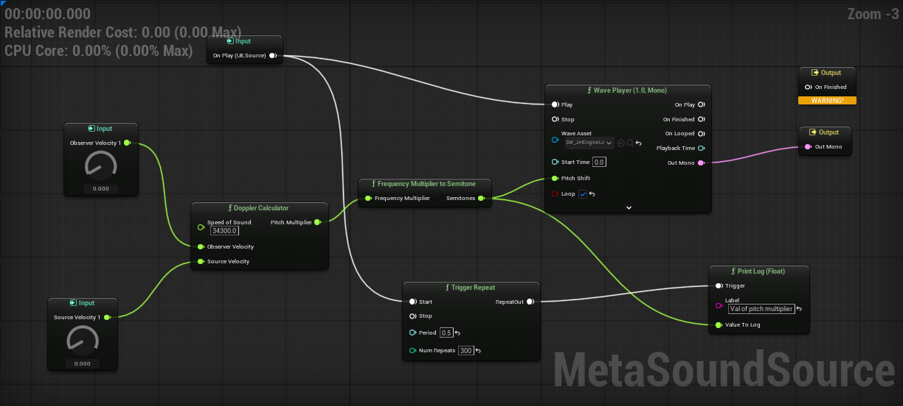

<picture>
  <source media="(prefers-color-scheme: dark)" srcset="Docs/images/doppler_curve_dark.svg">
  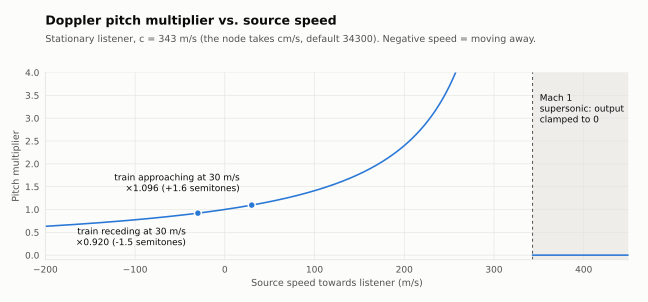
</picture>

The train cruises at about 18.6 m/s, which should give roughly ±0.95 semitones either side of the pass. To check it, the player stands still under the track while the thruster's position is logged every frame and the game's output is recorded. The line below is the pitch predicted from that path; the dots are the values the MetaSound printed while it played. ([listen](Docs/audio/flyby.wav), normalised; the engine's attenuation keeps it audible for only about three seconds around the pass.)

<picture>
  <source media="(prefers-color-scheme: dark)" srcset="Docs/images/ingame_flyby_dark.svg">
  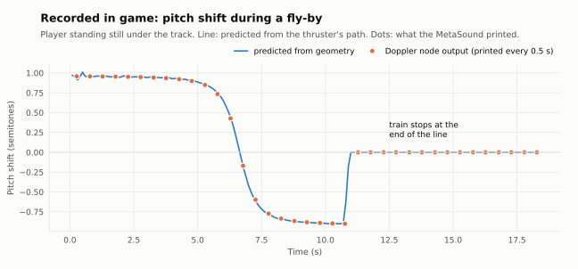
</picture>

## Tests

The tests use Unreal's automation framework and sit under `DspAp.Audio.*`:

- `CircularBuffer`: adding, storing, reading back and wrap-around, each with a basic case, a large case (up to 2.2 million samples) and an edge case, plus two safety tests for out-of-range delays and a zero-length buffer.
- `Doppler`: stationary, approaching, receding, both moving, exactly Mach 1 and supersonic.

Run them headless with

```powershell
.\Scripts\RunTests.ps1
```

```
  [PASS] DspAp.Audio.CircularBuffer.1_Add.Basic
  ...
  [PASS] DspAp.Audio.Doppler.3_Limits.Supersonic

21 passed, 0 failed
```

or in the editor from Tools > Test Automation, filtered by `DspAp`.

## Building from source

You need Windows, Unreal Engine 5.7 from the Epic Games Launcher, Visual Studio 2022 or 2026 with the "Game development with C++" workload (`.vsconfig` lists the components), and Git LFS for the `.uasset` files.

```powershell
git lfs install
git clone https://github.com/madam6/tokyo-doppler.git
cd tokyo-doppler
.\Scripts\Build.ps1       # compiles the C++ module, about a minute
.\Scripts\RunTests.ps1    # optional
```

Then open `TokyoDoppler.uproject`. The scripts find the engine through the launcher's install list; for a source build or an unusual location pass `-EngineDir "D:\UE_5.7"` or set `UE_ENGINE_DIR`. If PowerShell refuses to run them, use `powershell -ExecutionPolicy Bypass -File .\Scripts\Build.ps1`. If the compiler stops with C3859 or C1076 (out of virtual memory, usually a small pagefile), run `.\Scripts\Build.ps1 -MaxParallelActions 2`.

### Third-party content

The level is built from two Fab packs that can't be redistributed in a public repository:

| Pack | Goes in | Provides |
|---|---|---|
| [Tokyo Stylized Environment](https://www.fab.com/listings/9eec7a8a-b17c-4b89-a0d9-369a6ed5ac8c) | `Content/TokyoStylizedEnvironment` | the city, the maglev and the sequence that moves it |
| [Rocket Thruster Exhaust FX](https://www.fab.com/listings/5856e437-bb4a-4215-ae6d-6c93b429a37e) | `Content/RocketThrusterExhaustFX` | the green exhaust and the thruster mesh |

Add both to the project from Fab. Without them the code still builds, the tests pass and the MetaSounds open and play, but `Maps/TokyoDoppler` loads with missing meshes. The packaged build in Releases has everything.

To package the game yourself once the packs are in place:

```powershell
.\Scripts\Package.ps1     # Shipping build in Build\Package\Windows, about 585 MB
```

## Project layout

```
Source/DspAp/
  Audio/DelayLine/        circular buffer and delay line node
  Audio/DopplerEffect/    Doppler calculator node
  Tests/                  automation tests for both
  DspAp.cpp               module startup, registers the MetaSound nodes
  DspApCharacter.* ...    first-person character, weapon and projectile (from Epic's template)
Content/
  Audio/                  MSS_DelayLineGunshot, MSS_DopplerJetEngine, SW_JetEngineLoop, ATT_JetEngine
  Blueprints/             BP_DopplerThruster
  Maps/TokyoDoppler       the demo level
Scripts/                  Build, RunTests, Package
Docs/                     images, in-game recordings, and the scripts in plots/ that draw the figures
```

## Known limitations

- The Doppler effect is a pitch shift on the Wave Player, updated at control rate from a Blueprint tick. It doesn't model propagation delay; a variable-length delay line driven by distance would produce both the pitch change and the arrival lag. Velocity comes from the per-frame position change, so it gets noisy at low frame rates.
- Changing the delay time while sound is playing moves the read head in one jump, with no interpolation, so modulating it clicks. Delay times are truncated to whole samples and capped at 2 s.
- The rifle's MetaSound uses the one-shot interface, so the source ends when the Wave Player finishes and the echo tail is cut off about 1.7 s after the shot (visible in the recording above). Holding `On Finished` back until the tail has decayed would fix it.
- Windows only. Tested with UE 5.7.3 and Visual Studio 2026; UnrealBuildTool warns that the 2026 compiler isn't its preferred version but the build is clean.

## License

The original code is MIT licensed, see [LICENSE](LICENSE). The first-person character, weapon and projectile classes and the content in `FirstPerson/`, `FPWeapon/` and `FirstPersonArms/` come from Epic's First Person template and fall under the Unreal Engine EULA. The two Fab packs belong to their authors and are not included.
